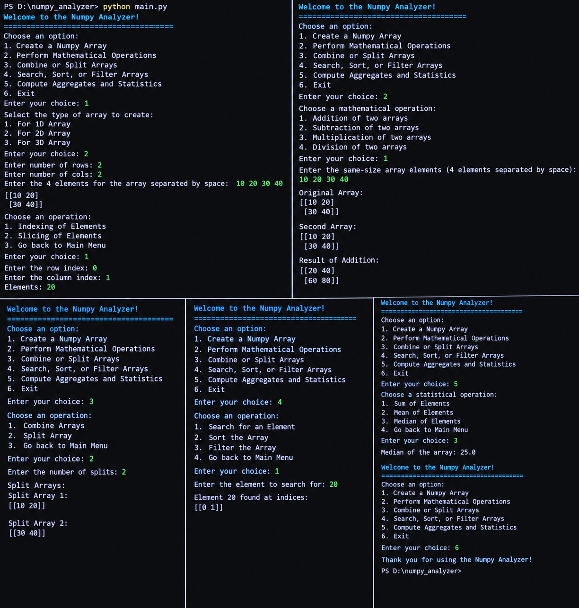

# NumPy Analyzer

## Subtitle of the Project

A simple Python project that creates and analyzes NumPy arrays, performs mathematical operations, combines or splits arrays, searches, sorts, filters elements, and computes basic statistics.

## About the Project

This project is a beginner-friendly Python program that provides an interactive, menu-driven interface for working with NumPy arrays.

The program allows the user to select from the following options:

* Create a 1D, 2D, or 3D NumPy array.
* Perform indexing and slicing operations on array elements.
* Perform addition, subtraction, multiplication, and division on two arrays of the same shape.
* Combine arrays.
* Split an array into smaller arrays.
* Search for an element and display its index or indices.
* Sort array elements.
* Filter array elements using comparison conditions.
* Calculate the sum, mean, and median of array elements.
* Exit the program.

The program is organized using a `numpy_analyzer` class. The `main_menu()` function displays the main menu and calls the appropriate class methods based on the user's selection.

The project uses the NumPy library to create arrays and perform array operations, mathematical calculations, searching, sorting, filtering, splitting, and statistical computations.

The program continues displaying the main menu until the user chooses the Exit option.

## Output



## Features

* Displays an interactive main menu.
* Creates 1D, 2D, and 3D NumPy arrays.
* Accepts user input to populate arrays.
* Performs indexing on 1D, 2D, and 3D arrays.
* Performs slicing on 1D, 2D, and 3D arrays.
* Performs element-wise addition of two arrays.
* Performs element-wise subtraction of two arrays.
* Performs element-wise multiplication of two arrays.
* Performs element-wise division of two arrays.
* Checks that the second array contains the expected number of elements.
* Prevents division when the second array contains zero.
* Combines arrays vertically.
* Splits arrays along the first axis.
* Searches for elements and displays their indices.
* Sorts array elements.
* Filters elements that are greater than, less than, or equal to a specified value.
* Calculates the sum of array elements.
* Calculates the mean of array elements.
* Calculates the median of array elements.
* Uses exception handling to manage invalid input and operation errors.
* Uses functions and class methods to organize different operations.
* Uses loops and conditional statements to manage menu selections.
* Allows the user to return to the main menu or exit the program.

## Concepts Used

* Variables and data types.
* User input and output.
* Type conversion using `int()`.
* Lists and list conversion using `list()`.
* Functions and method calls.
* Classes and objects.
* Object-oriented programming.
* NumPy arrays.
* Array dimensions and shapes.
* Creating arrays using `np.array()`.
* Reshaping arrays using `reshape()`.
* Array indexing and slicing.
* Array attributes such as `ndim`, `size`, and `shape`.
* Element-wise mathematical operations.
* Array combining using `np.vstack()`.
* Array splitting using `np.array_split()`.
* Searching using `np.argwhere()`.
* Sorting using `np.sort()`.
* Boolean indexing and filtering.
* Aggregate calculations using `np.sum()`.
* Mean calculation using `np.mean()`.
* Median calculation using `np.median()`.
* Checking array values using `np.any()`.
* Exception handling using `try` and `except`.
* Conditional statements using `if`, `elif`, and `else`.
* `while` loops and `for` loops.
* Menu-driven programming.
* Modular organization of program operations.

## Built-in Functions and Methods Used

* print()
* input()
* int()
* list()
* map()
* len()
* range()
* reshape()
* add()
* subtract()
* multiply()
* divide()
* vstack()
* array_split()
* argwhere()
* sort()
* sum()
* mean()
* median()
* break

## Technology Used

* Python
* NumPy
* Visual Studio Code (VS Code)
* Git
* GitHub

## How to Run

### Step 1: Install Python

Download and install Python from the official website:

```bash
https://www.python.org/downloads/
```

### Step 2: Install NumPy

Open the terminal and run:

```bash
python -m pip install numpy
```

### Step 3: Open the Project

Open the project folder `numpy_analyzer` in Visual Studio Code.

### Step 4: Run the Program

Open the terminal in the project directory and execute:

```bash
python main.py
```

## Project Structure

```text
│
├── main.py
├── output.png
└── README.md
```

## Learning Objectives

By completing this project, you can learn:

* How to create and use NumPy arrays.
* How to create 1D, 2D, and 3D arrays.
* How to access and slice array elements.
* How to perform mathematical operations on arrays.
* How to combine and split arrays.
* How to search for values and identify their indices.
* How to sort array elements.
* How to filter arrays using comparison conditions.
* How to calculate sum, mean, and median.
* How to use NumPy functions for array processing.
* How to use classes and methods to organize a Python program.
* How to handle invalid input using exception handling.
* How to use loops and conditional statements.
* How to create a menu-driven application.
* How to manage a Python project using VS Code, Git, and GitHub.

## Author

Anjali Mehta
